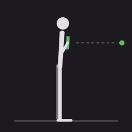
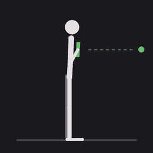
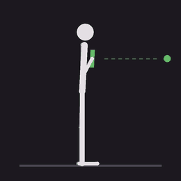
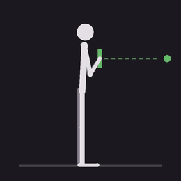
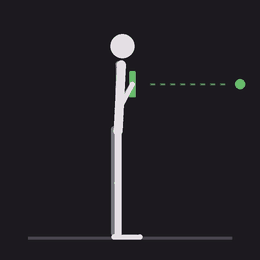
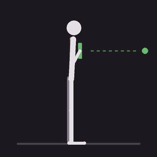

# Alarma Sentadillas (Android)

Alarma que **solo se apaga haciendo sentadillas**, al estilo de la misión «sentadillas» de Alarmy.
Detecta el movimiento con los sensores del teléfono (sostenido contra el pecho). Antes de usarla, una fase de
preconfiguración bayesiana la ajusta a ti con series de sentadillas, pruebas de falsación y preguntas de
verificación. Mientras suena, cierra el menú de apagado para que no se pueda apagar el teléfono.

## Obtener el APK

**GitHub Actions (sin instalar nada):** cada push a `main` compila el APK firmado (~3 min) y lo publica en
**Releases** como `SquatAlarm.apk`. **Android Studio:** `File → Open` → carpeta → **Run ▶**.

Todas las builds usan la misma clave (`keystore/squatalarm.jks`, contraseña `squatalarm`), así que cada APK nuevo
se instala encima del anterior sin desinstalar. Requisitos: Android 8.0+ (API 26).

## Primer uso

1. **Permisos** → concede todos (6; 7 con la misión del sensor). Si sale «A la app se le negó el acceso», ver [Permisos bloqueados](#permisos-bloqueados-y-play-protect).
2. **Preconfigurar** (unos 8–10 min, ver abajo). Se guarda sola al terminar.
3. **Probar detección**: cada sentadilla suma 1. Cuando un movimiento no cuenta, la pantalla dice por qué
   (p. ej. «el torso no se inclinó (¿solo brazos?)»).
4. **Probar alarma en 10 s**, bloquear el teléfono y esperar. En modo prueba hay botón para apagarla; en la real no.
5. Hora, días, número de sentadillas y **apagado de seguridad** (minutos tras los que se apaga sola si la detección
   fallara; es la única salida sin sentadillas). Activar el interruptor.

## Misión alternativa: caminar hasta un sensor de movimiento

En **Para apagar la alarma**, elige «Caminar hasta un sensor de movimiento». La alarma se apaga cuando llega una
notificación **nueva**, posterior al inicio de la alarma, de la app del sensor y con el texto elegido. Por ejemplo,
SwitchBot «sensor espacios: Movimiento detectado» si el sensor está en la cocina.

1. **Revisar permisos** → concede **Acceso a notificaciones**. Si sale «Ajuste restringido», usa el mismo
   procedimiento de abajo.
2. **Elegir la notificación del sensor**: aparecen las notificaciones visibles. Toca la del sensor; si no está, pasa
   frente a él y la nueva aparecerá en la lista. Se guardan la app y el texto, y el texto se puede editar. Por
   ejemplo, «Movimiento detectado» acepta cualquier sensor de esa app, mientras que «sensor espacios» acepta solo
   ese.
3. **Probar alarma en 10 s** y camina hasta el sensor.

La app lee la notificación con el permiso estándar de Android (`NotificationListenerService`). No captura la
pantalla y no guarda ni envía otras notificaciones; además, la app no tiene permiso de Internet. Limitaciones:
depende de que el sensor y su app avisen (internet, hub y nube del fabricante); si otra persona pasa frente al
sensor, también la apaga; si el sensor ya estaba en estado «movimiento», puede no avisar de nuevo hasta que se
despeje. Si no llega nada, actúa el apagado de seguridad.

## Respaldo de parámetros

Al instalar una versión nueva **encima** de la anterior (misma firma), los parámetros se conservan; solo se pierden
al desinstalar. **Respaldo de parámetros → Exportar** guarda un archivo de texto (`squatalarm-parametros.txt`) en la
carpeta que elijas (Descargas, Drive…), con la preconfiguración, la alarma, la misión y el sensor. **Importar** lo
restaura. Al importar, cada valor se valida con su tipo; si el archivo no es válido, no se cambia nada.

## Preconfiguración bayesiana

### Pasos

Las series de 10 sentadillas (30–60 en total) van **intercaladas** con 6 pruebas de falsación de 20 s, para que el
modelo aprenda desde el inicio qué es y qué no es una sentadilla y para repartir la fatiga. Antes de cada paso se ve
un GIF de la postura. Un pitido marca el inicio y, en las falsaciones, también el final, porque con el teléfono contra
el pecho no se ve la pantalla. Tras cada paso la app dice cuánto contó y pregunta qué hiciste realmente; si el
conteo no coincide, la diferencia queda registrada como falsos positivos o falsos negativos.

<table>
<tr>
<td align="center"> Serie de sentadillas</td>
<td align="center"> Falsación: quieto</td>
<td align="center"> Falsación: caminar</td>
<td align="center"> Falsación: sacudir</td>
</tr>
<tr>
<td align="center"> Falsación: inclinarse (rodillas rectas)</td>
<td align="center"> Falsación: solo brazos, lento y vertical</td>
<td align="center"> Falsación: solo brazos, rápido</td>
<td></td>
</tr>
</table>

La línea punteada marca la altura del teléfono de pie y el punto verde su altura actual. Los brazos pueden bajar
el teléfono tanto como una sentadilla, pero no lo inclinan como el torso.

### Torso vs. brazos

Además de los umbrales de amplitud y tiempo, cada ciclo candidato se mide con dos rasgos que separan el torso de
los brazos:

- **Inclinación**: es el ángulo máximo entre la gravedad al inicio del ciclo y la gravedad durante el ciclo, medida
  en el marco del teléfono. Con el teléfono contra el pecho, el torso se inclina al bajar (típicamente 15–45°). Si
  se mueve el teléfono vertical con los brazos, la inclinación queda en ~0°. Si se inclina la cintura con las
  rodillas rectas, se pasa de 60°.
- **Pico máximo de aceleración**: los brazos mueven el teléfono mucho más bruscamente que el cuerpo entero.

Un ciclo que cae fuera de la ventana de inclinación o supera el pico máximo **no cuenta** (veto).

### Modelo

Cada combinación θ de parámetros define una configuración del detector: umbral de bajada y de subida
(0,4–3,0 m/s²), tiempo mínimo bajada→subida (300/400/500 ms), pico máximo (sin límite, 12, 9, 7, 5,5, 4,5 o
3,5 m/s²) y ventana de inclinación (mínimo 0/5/10/20°, máximo 180/90/60/45/30°). En total son 306.180
combinaciones, y cada una tiene sus propios posteriores:

- sensibilidad S_θ ~ Beta(1 + VP_θ, 1 + FN_θ)
- especificidad E_θ ~ Beta(1 + VN_θ, 1 + FP_θ)

La previa es uniforme, Beta(1,1).

- **Unidad de análisis**: cada tramo se divide en ventanas del largo de una sentadilla tuya, calculado como la
  duración de la primera serie dividida por las sentadillas declaradas. En cada tramo, las sentadillas declaradas
  son positivas y el resto de las ventanas son negativas. Si la app cuenta de más, el exceso son falsos positivos;
  si cuenta de menos, el faltante son falsos negativos.
- **Actualización por paso**: tras cada paso, solo ese tramo se re-analiza con todas las θ y los conteos se suman,
  porque el modelo es conjugado. Los vetos se aplican después del análisis, lo que da exactamente el mismo resultado
  que contar en vivo, y una prueba automática lo verifica. El detector pasa a la θ con mayor utilidad esperada a
  posteriori, **w·E[S] + (1−w)·E[E]**: la «exigencia» se adapta paso a paso y se ve en vivo en el paso siguiente.
- **Empates**: gana el veto menos restrictivo, porque sin evidencia de trampa no se impone uno, y después el centro
  de la meseta de umbrales.
- **Resultados**: medias posteriores con intervalos de credibilidad del 95 % (colas iguales, cuantiles exactos de la
  Beta), la traza de aprendizaje paso a paso, la comparación con los valores por defecto y el conteo por paso. El
  peso w se cambia al final y el resultado se recalcula al instante, sin volver a analizar.
- **Validación** (opcional, recomendada): 10 sentadillas, caminar y solo brazos, con datos que **no** se usaron en
  el ajuste. Muestra el posterior, P(S ≥ 0,8) y P(E ≥ 0,9). Las cifras de entrenamiento son optimistas porque θ se
  eligió con esos mismos datos; las de validación no.

## Permisos bloqueados y Play Protect

Son dos bloqueos distintos.

### 1. «A la app se le negó el acceso» / «Ajuste restringido» (Android 13+)

Android bloquea **Servicio de accesibilidad**, **Mostrar sobre otras apps** y **Acceso a notificaciones** (y en Android 15, otros más) en las apps
instaladas desde un APK descargado. **No lo bloquea Google Play y no hay que pedirle nada a nadie**: se desbloquea en
el teléfono, una vez por app.

1. En la app, ve a **Permisos** → **Conceder** en el permiso bloqueado → aparece el aviso → **Cerrar**. Este intento
   es necesario: la opción del paso 2 solo aparece después.
2. Toca **Abrir info de la app** (en la misma pantalla de Permisos), o ve a Ajustes → Aplicaciones → Alarma
   Sentadillas. Ahí: **⋮** (arriba a la derecha) → **Permitir ajustes restringidos** → confirma con tu PIN o huella.
3. Vuelve a **Permisos** y toca **Conceder** en ambos.

Si no ves la opción, busca «restringidos» en el buscador de Ajustes; algunas capas de fabricante la cambian de lugar.

### 2. Aviso de Play Protect («App no reconocida», «puede robar tu información»)

- **Para instalar**: toca **Más detalles → Instalar de todas formas**. Si esa opción no aparece, ve a Play Store →
  tu perfil → **Play Protect** → ⚙️, desactiva **Analizar apps con Play Protect**, instala y vuelve a activarlo.
- **Para pedirle a Google que deje de marcarla** (opcional): usa el
  [formulario de apelación de Play Protect](https://support.google.com/googleplay/android-developer/contact/protectappeals).
  Pide correo, nombre de desarrollador, paquete `com.squatalarm.app`, el **SHA-256 del APK** analizado en VirusTotal
  y una justificación. Primero sube el APK a [virustotal.com](https://www.virustotal.com): al terminar el análisis,
  la pestaña *Details* muestra el SHA-256 para copiarlo. Google no responde y la decisión es final. Cada build nuevo
  tiene otro SHA-256.

  Justificación lista para pegar:

  > SquatAlarm is a personal, open-source alarm clock (https://github.com/AGSCL/SquatAlarm) that only turns off after
  > the user performs squats detected with the accelerometer. It uses AccessibilityService exclusively to close the
  > power menu while the alarm is ringing, and SYSTEM_ALERT_WINDOW only to bring the alarm screen back to the
  > foreground. The app does not request the INTERNET permission, so it cannot transmit any data. The source code
  > and the build pipeline (GitHub Actions) are public.

- **La vía que elimina ambos avisos**: publicarla en Google Play (cuenta de desarrollador, track de prueba interna).
  Instalada desde Play, no hay ajustes restringidos ni aviso de Play Protect. Google exige declarar el uso de
  Accesibilidad.

## Cómo funciona

- `squat/SquatCounter.kt` (Kotlin puro): proyecta la aceleración lineal sobre la gravedad, la filtra (~2–3 Hz) y busca
  el patrón de una sentadilla (lóbulo negativo → lóbulo positivo). Mide la inclinación del ciclo y aplica los vetos.
- `squat/Tuner.kt`: `BayesTuner` (posteriores por combinación, actualización por paso), `BetaDist` (CDF y cuantiles
  exactos), conteos por ventanas.
- `squat/SquatDetector.kt`: capa de sensores (gravedad + aceleración lineal; respaldo con acelerómetro).
- `alarm/`: `setAlarmClock` → servicio en primer plano (sonido de alarma a volumen máximo, vibración, wakelock) →
  pantalla sobre el bloqueo, fijada (`startLockTask`). Atrás y volumen no hacen nada. Un vigilante la vuelve a traer
  al frente.
- `block/PowerMenuBlockerService` (accesibilidad): cierra el menú de apagado en cuanto aparece. Si el teléfono igual
  se reinicia (botón de encendido 10+ s), la alarma vuelve a sonar al encender. Para el bloqueo total del menú,
  ver «device owner» abajo.

### Bloqueo al 100 % (opcional, avanzado)

Requiere un teléfono sin cuentas configuradas y ADB:
`adb shell dpm set-device-owner com.squatalarm.app/.block.AdminReceiver`. Para revertir:
`adb shell dpm remove-active-admin com.squatalarm.app/.block.AdminReceiver`.

## Pruebas y herramientas

- `core-check/run.sh`: compila el código puro (contador, vetos, motor bayesiano, Beta, archivo de respaldo, regla
  del sensor) con el Kotlin embebido de Gradle y
  corre las pruebas con señales sintéticas. Verifica que los vetos atrapan los brazos, que los cuantiles coinciden con
  SciPy, que la actualización incremental coincide con la evaluación desde cero y que el peso actúa en la dirección
  correcta. Solo necesita `gradle`.
- `tools/make_guides.py`: regenera los GIFs de postura (requiere Pillow).

## Limitaciones

- Ningún sensor del teléfono puede impedir del todo la trampa: quien mueva el teléfono con los brazos **imitando a la
  vez** amplitud, ritmo e inclinación del torso puede engañarlo. Las falsaciones miden cuán difícil es; «solo brazos,
  lento» es la más exigente.
- Algunas capas de fabricante (Xiaomi, Huawei) matan servicios en segundo plano: concede «sin restricción de batería»
  y, si existe, «inicio automático».
